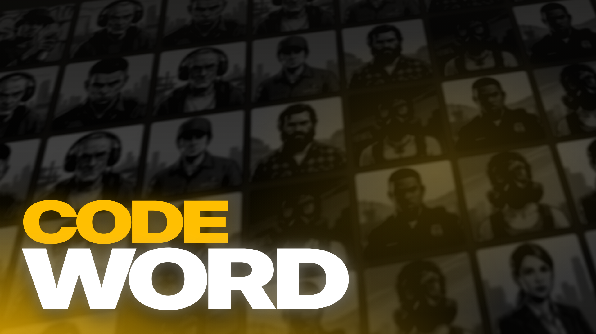

# Codeword for FiveM

🇭🇺 [Magyar](#magyar) · 🇬🇧 [English](#english)

---

## Magyar

A **Codeword** egy FiveM-re készült, JavaScriptben írt társasjáték, amelyet a népszerű
**Codenames** ihletett.

Két csapat versenyez egy 5×5-ös táblán, hogy megtalálja a saját ügynökeit. A csapatok
kémfőnökei egyszavas tippeket adnak, a csapattársak pedig szavazással döntik el, melyik
kártyát fordítják fel. Az nyer, aki előbb megtalálja az összes ügynökét. A merénylőt
viszont messziről kerüld el!

A táblát a `/codeword` paranccsal bárhova lerakhatod (vagy beteheted a propot az MLO-dba).
Menj oda, és nyomd meg az **E** gombot a csatlakozáshoz.

### Használat

Szabadon használható, módosítható, és beépíthető a saját szerveredbe.
Ha használod, megköszönöm, ha feltünteted a nevem: **Bencso** 🙂

### Jogi nyilatkozat

A Codeword egy nem hivatalos, rajongó által készített játék, amely a Codenames
játékmenetére épül. **Nem** az eredeti játék, és semmilyen kapcsolatban nem áll a
Czech Games Editionnel vagy a Codenames alkotóival, és nem is támogatják.
A „Codenames” és a „Fedőnevek” név, valamint az eredeti játék grafikái a jogtulajdonos
védjegyei, illetve szellemi tulajdonai. A projekt nem használ fel eredeti játékanyagot.

---

## English

**Codeword** is a party game for FiveM, written in JavaScript and inspired by the popular
board game **Codenames**.

Two teams compete to find their agents on a 5×5 board. Each team's spymaster gives
one-word clues, and their teammates vote on which cards to reveal. Find all your agents
first, but avoid the assassin!

Place the board anywhere with `/codeword` (or put the prop in your MLO), walk up to it,
and press **E** to join.

### Usage

Free to use, modify and include on your server.
If you use it, I'd appreciate it if you credited me: **Bencso** 🙂

### Disclaimer

Codeword is an unofficial, fan-made game based on the gameplay of Codenames. It is
**not** the original game and is not affiliated with, endorsed by, or connected to
Czech Games Edition or the creator of Codenames. "Codenames" and its
original artwork are trademarks and intellectual property of their respective owners.
No original game assets are used in this project.
